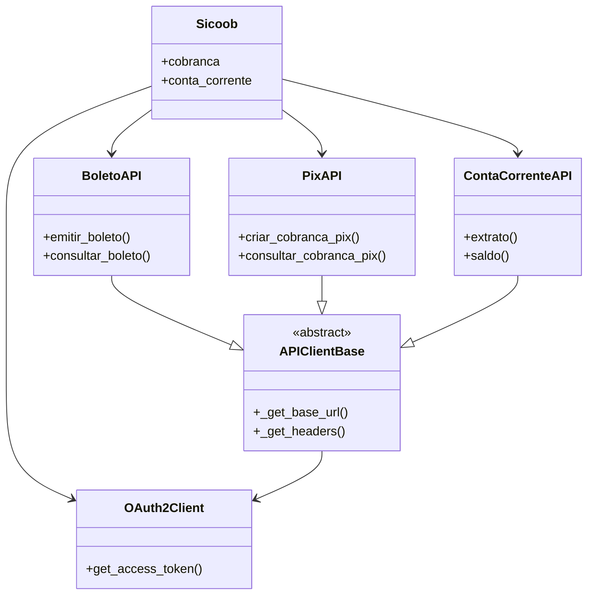

# Documentação da Biblioteca Sicoob API

## Visão Geral
Biblioteca Python para integração com a API do Banco Sicoob, incluindo:
- Autenticação OAuth2
- Cobrança (Boletos e PIX)
- Conta Corrente
- Operações bancárias

## Índice
1. [Classe Principal](#classe-sicoob)
2. [Autenticação](#autenticação-oauth2)
3. [Serviços](#serviços)
   - [Boletos](#api-de-boletos)
   - [PIX](#api-de-pix)
   - [Conta Corrente](#api-de-conta-corrente)
4. [Classe Base](#classe-base)
5. [Diagrama de Relacionamentos](#diagrama-de-relacionamentos)
6. [Exemplos de Uso](#exemplos-de-uso)

---

## Classe Sicoob
Cliente principal que fornece acesso a todos os serviços.

**Arquivo:** `sicoob/client.py`

### Métodos:
- `__init__(client_id=None, client_secret=None, certificado=None, chave_privada=None)`
  - Inicializa o cliente com credenciais

### Propriedades:
- `cobranca`: Acesso às APIs de Cobrança (Boleto e PIX)
- `conta_corrente`: Acesso à API de Conta Corrente

---

## Autenticação OAuth2
**Arquivo:** `sicoob/auth/oauth.py`

### Classe: OAuth2Client
Gerencia tokens de acesso com escopos específicos.

#### Métodos:
- `get_access_token(scope=None)`: Obtém token para o escopo especificado
- `_is_token_expired(scope)`: Verifica se token expirou (método interno)

#### Escopos Comuns:
- **Boletos**: `"boletos_inclusao boletos_consulta..."`
- **Conta Corrente**: `"cco_consulta cco_transferencias..."`
- **PIX**: `"cob.write cob.read..."`

---

## Serviços

### API de Boletos
**Arquivo:** `sicoob/boleto.py`

#### Classe: BoletoAPI
Operações com boletos bancários.

#### Métodos:
- `emitir_boleto(dados_boleto)`: Emite novo boleto
- `consultar_boleto(nosso_numero)`: Consulta boleto existente

### API de PIX
**Arquivo:** `sicoob/pix.py`

#### Classe: PixAPI
Operações com PIX.

#### Métodos Principais:
- `criar_cobranca_pix(txid, dados)`: Cria cobrança imediata
- `consultar_cobranca_pix(txid)`: Consulta cobrança
- `configurar_webhook(chave, url)`: Configura webhook

### API de Conta Corrente
**Arquivo:** `sicoob/conta_corrente.py`

#### Classe: ContaCorrenteAPI
Operações bancárias.

#### Métodos:
- `extrato()`: Obtém extrato por período
- `saldo()`: Consulta saldo
- `transferencia()`: Realiza transferência

---

## Classe Base
**Arquivo:** `sicoob/api_client.py`

### Classe: APIClientBase
Fornece funcionalidades comuns a todas as APIs.

#### Métodos:
- `_get_base_url()`: Retorna URL conforme sandbox/produção
- `_get_headers(scope)`: Retorna headers com autenticação

---

## Diagrama de Relacionamentos



---

## Exemplos de Uso

```python
from sicoob import Sicoob
from sicoob.auth import OAuth2Client
import requests

# Configuração
oauth = OAuth2Client(client_id, client_secret, certificado, chave)
session = requests.Session()
sicoob = Sicoob(oauth_client=oauth, session=session)

# Uso dos serviços
extrato = sicoob.conta_corrente.extrato(
    mes=6, ano=2025, dia_inicial=1, dia_final=30, 
    numero_conta_corrente=123456
)

boleto = sicoob.cobranca.boleto.emitir_boleto({
    "numeroContrato": 123456,
    "modalidade": 1,
    "valor": 100.50
})

pix = sicoob.cobranca.pix.criar_cobranca_pix(
    "tx123", 
    {"valor": {"original": "100.50"}}
)
