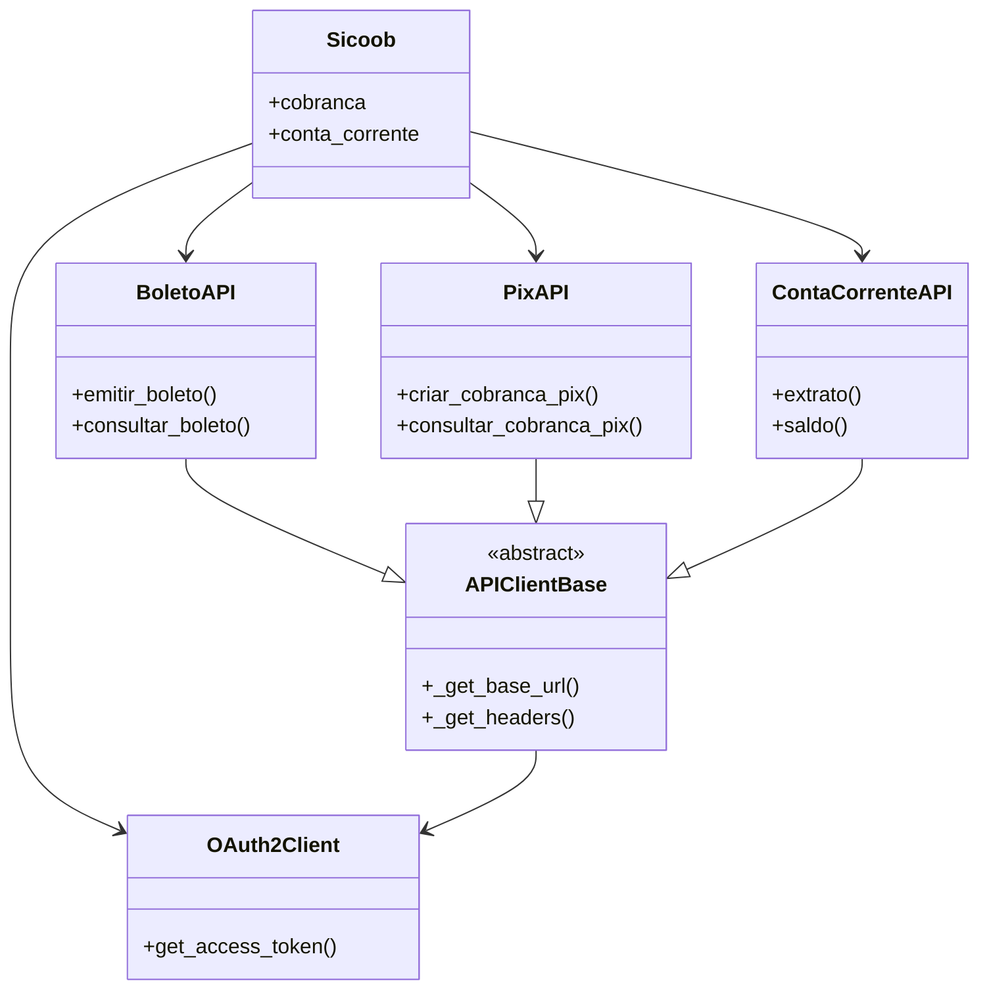

# Documentação da Biblioteca Sicoob API

## Visão Geral
Biblioteca Python para integração com a API do Banco Sicoob, incluindo:
- Autenticação OAuth2
- Cobrança (Boletos e PIX)
- Conta Corrente
- Operações bancárias

## Índice
1. [Classe Principal](#classe-sicoob)
2. [Autenticação](#autenticação-oauth2)
3. [Serviços](#serviços)
   - [Boletos](#api-de-boletos)
   - [PIX](#api-de-pix)
   - [Conta Corrente](#api-de-conta-corrente)
4. [Classe Base](#classe-base)
5. [Diagrama de Relacionamentos](#diagrama-de-relacionamentos)
6. [Exemplos de Uso](#exemplos-de-uso)

---

## Classe Sicoob
Cliente principal que fornece acesso a todos os serviços.

**Arquivo:** `sicoob/client.py`

### Métodos:
- `__init__(client_id=None, client_secret=None, certificado=None, chave_privada=None)`
  - Inicializa o cliente com credenciais

### Propriedades:
- `cobranca`: Acesso às APIs de Cobrança (Boleto e PIX)
- `conta_corrente`: Acesso à API de Conta Corrente

---

## Autenticação OAuth2
**Arquivo:** `sicoob/auth/oauth.py`

### Classe: OAuth2Client
Gerencia tokens de acesso com escopos específicos.

#### Métodos:
- `get_access_token(scope=None)`: Obtém token para o escopo especificado
- `_is_token_expired(scope)`: Verifica se token expirou (método interno)

#### Escopos Comuns:
- **Boletos**: `"boletos_inclusao boletos_consulta..."`
- **Conta Corrente**: `"cco_consulta cco_transferencias..."`
- **PIX**: `"cob.write cob.read..."`

---

## Serviços

### API de Boletos
**Arquivo:** `sicoob/boleto.py`

#### Classe: BoletoAPI
Operações com boletos bancários.

#### Métodos:
- `emitir_boleto(dados_boleto)`: Emite novo boleto
- `emitir_segunda_via(numero_cliente, codigo_modalidade, nosso_numero=None, linha_digitavel=None, codigo_barras=None, gerar_pdf=False, numero_contrato_cobranca=None, client_id=None)`:
  - Emite segunda via de um boleto existente
  - Parâmetros:
    - `numero_cliente` (int): Número do contrato do beneficiário
    - `codigo_modalidade` (int): Modalidade do boleto (1-8)
    - `nosso_numero` (int, opcional): Identificador do boleto
    - `linha_digitavel` (str, opcional): Linha digitável (47 posições)
    - `codigo_barras` (str, opcional): Código de barras (44 posições)
    - `gerar_pdf` (bool, opcional): Se True, retorna PDF em base64
    - `numero_contrato_cobranca` (int, opcional): ID do contrato de cobrança
    - `client_id` (str, opcional): ClientId para autenticação
  - Retorna: Dados do boleto ou PDF em base64 se gerar_pdf=True
  - Exceções: `BoletoEmissaoError` em caso de falha
- `consultar_boleto(nosso_numero)`: Consulta boleto existente
- `consultar_boletos_por_pagador(numero_cpf_cnpj, numero_cliente, client_id, codigo_situacao=None, data_inicio=None, data_fim=None)`:
  - Consulta lista de boletos por pagador
  - Parâmetros:
    - `numero_cpf_cnpj` (str): CPF/CNPJ do pagador (máx 14 caracteres)
    - `numero_cliente` (int): Número do contrato do beneficiário
    - `client_id` (str): ClientId para autenticação
    - `codigo_situacao` (int, opcional): Código da situação (1-Em Aberto, 2-Baixado, 3-Liquidado)
    - `data_inicio` (str, opcional): Data de vencimento inicial (formato yyyy-MM-dd)
    - `data_fim` (str, opcional): Data de vencimento final (formato yyyy-MM-dd)
  - Retorna: Lista de boletos encontrados
  - Exceções: `BoletoConsultaPagadorError` em caso de falha

- `consultar_faixas_nosso_numero(numero_cliente, codigo_modalidade, quantidade, client_id, numero_contrato_cobranca=None)`:
  - Consulta faixas de nosso número disponíveis
  - Parâmetros:
    - `numero_cliente` (int): Número do contrato do beneficiário
    - `codigo_modalidade` (int): Modalidade do boleto (1-Simples, 3-Caucionada, 4-Vinculada, 8-Conta Capital)
    - `quantidade` (int): Quantidade mínima de números disponíveis requeridos
    - `client_id` (str): ClientId para autenticação
    - `numero_contrato_cobranca` (int, opcional): ID do contrato de cobrança
  - Retorna: Dicionário com:
    - `numeroInicial`: Número inicial da faixa
    - `numeroFinal`: Número final da faixa
    - `validaDigitoVerificadorNossoNumero`: Indica se deve calcular DV (0-não, 1-sim)
  - Exceções: `BoletoConsultaFaixaError` em caso de falha
  - Exemplo:
    ```python
    faixas = sicoob.cobranca.boleto.consultar_faixas_nosso_numero(
        numero_cliente=123456,
        codigo_modalidade=1,
        quantidade=100,
        client_id="client-id-123"
    )
    ```

- `alterar_boleto(nosso_numero, dados_alteracao, client_id)`:
  - Altera dados de um boleto existente
  - Parâmetros:
    - `nosso_numero` (int): Número identificador do boleto no Sisbr
    - `dados_alteracao` (dict): Dicionário com os dados a serem alterados (apenas um objeto por requisição)
      - Objetos suportados: `seuNumero`, `desconto`, `abatimento`, `multa`, `jurosMora`, `rateioCredito`, `pix`, `prorrogacaoVencimento`, `prorrogacaoLimitePagamento`
    - `client_id` (str): ClientId para autenticação
  - Retorna: None em caso de sucesso (status 204)
  - Exceções: `BoletoAlteracaoError` em caso de falha (status 400, 406, 500)
  - Exemplo:
    ```python
    sicoob.cobranca.boleto.alterar_boleto(
        nosso_numero=123456789,
        dados_alteracao={
            "desconto": {
                "tipoDesconto": 1,
                "dataPrimeiroDesconto": "2025-06-10",
                "valorPrimeiroDesconto": 10.50
            }
        },
        client_id="client-id-123"
    )
    ```

- `alterar_pagador(pagador, client_id)`:
  - Altera informações do cadastro do pagador
  - Parâmetros:
    - `pagador` (dict): Dicionário com os dados do pagador contendo:
      - `numeroCliente` (int): Número do cliente
      - `numeroCpfCnpj` (str): CPF/CNPJ do pagador
      - `nome` (str): Nome do pagador
      - `endereco` (str): Endereço completo
      - `bairro` (str): Bairro
      - `cidade` (str): Cidade
      - `cep` (str): CEP
      - `uf` (str): UF (sigla do estado)
      - `email` (str): Email do pagador
    - `client_id` (str): ClientId para autenticação
  - Retorna: None em caso de sucesso (status 204)
  - Exceções: `BoletoAlteracaoPagadorError` em caso de falha (status 400, 406, 500)
  - Exemplo:
    ```python
    sicoob.cobranca.boleto.alterar_pagador(
        pagador={
            "numeroCliente": 5224,
            "numeroCpfCnpj": "12345678901",
            "nome": "Fulano de Tal",
            "endereco": "Rua Teste, 123",
            "bairro": "Centro",
            "cidade": "São Paulo",
            "cep": "01001000",
            "uf": "SP",
            "email": "fulano@teste.com"
        },
        client_id="client-id-123"
    )
    ```

- `baixar_boleto(nosso_numero, dados_boleto, client_id)`:
  - Comanda a baixa de um boleto existente
  - Parâmetros:
    - `nosso_numero` (int): Número identificador do boleto no Sisbr
    - `dados_boleto` (dict): Dicionário com os dados do boleto contendo:
      - `numeroCliente` (int): Número do cliente
      - `codigoModalidade` (int): Código da modalidade
    - `client_id` (str): ClientId para autenticação
  - Retorna: None em caso de sucesso (status 204)
  - Exceções: `BoletoBaixaError` em caso de falha (status 400, 406, 500)
  - Exemplo:
    ```python
    sicoob.cobranca.boleto.baixar_boleto(
        nosso_numero=123456789,
        dados_boleto={
            "numeroCliente": 5224,
            "codigoModalidade": 1
        },
        client_id="client-id-123"
    )
    ```

- `cadastrar_webhook(webhook, client_id)`:
  - Cadastra um webhook para receber notificações de acordo com o tipo de movimento
  - Parâmetros:
    - `webhook` (dict): Dicionário com os dados do webhook contendo:
      - `url` (str): URL do webhook (obrigatório)
      - `codigoTipoMovimento` (int): Código do tipo de movimento (obrigatório)
        - 7: Pagamento (Baixa operacional)
      - `codigoPeriodoMovimento` (int): Código do período de movimento (obrigatório)
        - 1: Movimento atual (D0)
      - `email` (str, opcional): Email do associado
    - `client_id` (str): ClientId para autenticação
  - Retorna: Resposta da API com confirmação do cadastro (status 201)
  - Exceções: `BoletoWebhookError` em caso de falha (status 400, 406, 500)
  - Exemplo:
    ```python
    sicoob.cobranca.boleto.cadastrar_webhook(
        webhook={
            "url": "https://webhook.example.com/notificacoes",
            "codigoTipoMovimento": 7,
            "codigoPeriodoMovimento": 1,
            "email": "notificacoes@empresa.com"
        },
        client_id="client-id-123"
    )
    ```

- `consultar_webhook(id_webhook, codigo_tipo_movimento, client_id)`:
  - Consulta os detalhes de um webhook cadastrado
  - Parâmetros:
    - `id_webhook` (int): Identificador único do webhook
    - `codigo_tipo_movimento` (int): Código do tipo de movimento do webhook
      - 7: Pagamento (Baixa operacional)
    - `client_id` (str): ClientId para autenticação
  - Retorna: Dicionário com os dados do webhook conforme estrutura:
    ```json
    {
      "resultado": [
        {
          "idWebhook": 4,
          "url": "https://webhook.com",
          "email": "webhook@email.com",
          "codigoTipoMovimento": 7,
          "descricaoTipoMovimento": "Pagamento (Baixa operacional)",
          "codigoPeriodoMovimento": 1,
          "descricaoPeriodoMovimento": "Movimento atual (D0)",
          "codigoSituacao": 3,
          "descricaoSituacao": "Inativo",
          "dataHoraCadastro": "2024-09-03T00:27:18.483Z",
          "dataHoraUltimaAlteracao": "2024-09-06T12:24:11.296Z",
          "dataHoraInativacao": "2024-09-05T18:50:55.099Z",
          "descricaoMotivoInativacao": "Erro ao enviar notificação"
        }
      ]
    }
    ```
  - Exceções: `BoletoWebhookError` em caso de falha (status 400, 406, 500)
  - Exemplo:
    ```python
    webhook = sicoob.cobranca.boleto.consultar_webhook(
        id_webhook=4,
        codigo_tipo_movimento=7,
        client_id="client-id-123"
    )
    ```

- `atualizar_webhook(id_webhook, webhook, client_id)`:
  - Atualiza um webhook cadastrado
  - Parâmetros:
    - `id_webhook` (int): Identificador único do webhook
    - `webhook` (dict): Dicionário com os dados do webhook para atualização contendo:
      - `url` (str): Nova URL do webhook (obrigatório)
      - `email` (str, opcional): Novo email do associado
    - `client_id` (str): ClientId para autenticação
  - Retorna: None em caso de sucesso (status 204)
  - Observação: Ao modificar a URL, a situação do webhook será automaticamente alterada para '1 - Aguardando validação' e permanecerá assim até que a nova URL seja validada com sucesso.
  - Exceções: `BoletoWebhookError` em caso de falha (status 400, 406, 500)
  - Exemplo:
    ```python
    sicoob.cobranca.boleto.atualizar_webhook(
        id_webhook=4,
        webhook={
            "url": "https://new-webhook.example.com/notificacoes",
            "email": "novo-email@empresa.com"
        },
        client_id="client-id-123"
    )

- `excluir_webhook(id_webhook, client_id)`:
  - Remove permanentemente um webhook cadastrado, encerrando o envio de notificações para a URL vinculada
  - Parâmetros:
    - `id_webhook` (int): Identificador único do webhook (obrigatório)
    - `client_id` (str): ClientId para autenticação (obrigatório)
  - Retorna: None em caso de sucesso (status 204)
  - Exceções: `BoletoWebhookError` em caso de falha com os seguintes status:
    - 400: Erro de negócio (ex: webhook já excluído)
    - 406: Dados inconsistentes (ex: webhook não encontrado)
    - 500: Erro interno no servidor
  - Exemplo:
    ```python
    sicoob.cobranca.boleto.excluir_webhook(
        id_webhook=123,
        client_id="client-id-123"
    )
    ```

- `consultar_solicitacoes_webhook(id_webhook, data_solicitacao, client_id, pagina=None, codigo_solicitacao_situacao=None)`:
  - Consulta as solicitações de notificação para um webhook com base na data de solicitação informada
  - Retorna o histórico das tentativas de notificação, incluindo o status e a resposta da requisição
  - Parâmetros:
    - `id_webhook` (int, obrigatório): Identificador único do webhook
    - `data_solicitacao` (str, obrigatório): Data da solicitação no formato yyyy-MM-dd
    - `client_id` (str, obrigatório): ClientId utilizado na utilização do TOKEN
    - `pagina` (int, opcional): Número da página a ser consultada
    - `codigo_solicitacao_situacao` (int, opcional): Código da situação da solicitação do webhook:
      - 3: Enviado com sucesso
      - 6: Erro no envio
  - Retorna: Estrutura de dados conforme exemplo abaixo (status 200)
    ```json
    {
      "resultado": [
        {
          "paginalAtual": 1,
          "totalPaginas": 2,
          "totalRegistros": 100,
          "webhookSolicitacoes": [
            {
              "codigoWebhookSituacao": 3,
              "descricaoWebhookSituacao": "Validado com sucesso",
              "codigoSolicitacaoSituacao": 3,
              "descricaoSolicitacaoSituacao": "Enviado com sucesso",
              "codigoTipoMovimento": 7,
              "descricaoTipoMovimento": "Pagamento (Baixa operacional)",
              "codigoPeriodoMovimento": 1,
              "descricaoPeriodoMovimento": "Movimento atual (D0)",
              "descricaoErroProcessamento": "Erro ao enviar notificação",
              "dataHoraCadastro": "2024-09-04T15:43:56.000Z",
              "validacaoWebhook": false,
              "webhookNotificacoes": [
                {
                  "url": "https://webhook.com",
                  "dataHoraInicio": "2024-09-08T15:50:38.077Z",
                  "dataHoraFim": "2024-09-08T15:51:38.077Z",
                  "tempoComunicao": 60,
                  "codigoStatusRequisicao": 200,
                  "descricaoMensagemRetorno": "{\"messsage\":\"Webhook recebido com sucesso!\"}"
                }
              ]
            }
          ]
        }
      ]
    }
    ```
  - Exceções: `BoletoWebhookError` em caso de falha com os seguintes status:
    - 400: Erro de negócio (ex: data inválida)
    - 406: Dados inconsistentes (ex: webhook não encontrado)
    - 500: Erro interno no servidor
  - Exemplo:
    ```python
    solicitacoes = sicoob.cobranca.boleto.consultar_solicitacoes_webhook(
        id_webhook=123,
        data_solicitacao="2025-06-01",
        client_id="client-id-123",
        pagina=1,
        codigo_solicitacao_situacao=3  # Apenas sucessos
    )
    ```

### API de PIX
**Arquivo:** `sicoob/pix.py`

#### Classe: PixAPI
Operações com PIX.

#### Métodos Principais:
- `criar_cobranca_pix(txid, dados)`: Cria cobrança imediata
- `consultar_cobranca_pix(txid)`: Consulta cobrança
- `configurar_webhook(chave, url)`: Configura webhook

### API de Conta Corrente
**Arquivo:** `sicoob/conta_corrente.py`

#### Classe: ContaCorrenteAPI
Operações bancárias.

#### Métodos:
- `extrato()`: Obtém extrato por período
- `saldo()`: Consulta saldo
- `transferencia()`: Realiza transferência

---

## Classe Base
**Arquivo:** `sicoob/api_client.py`

### Classe: APIClientBase
Fornece funcionalidades comuns a todas as APIs.

#### Métodos:
- `_get_base_url()`: Retorna URL conforme sandbox/produção
- `_get_headers(scope)`: Retorna headers com autenticação

---

## Diagrama de Relacionamentos



---

## Exemplos de Uso

```python
from sicoob import Sicoob
from sicoob.auth import OAuth2Client
import requests

# Configuração
oauth = OAuth2Client(client_id, client_secret, certificado, chave)
session = requests.Session()
sicoob = Sicoob(oauth_client=oauth, session=session)

# Uso dos serviços
extrato = sicoob.conta_corrente.extrato(
    mes=6, ano=2025, dia_inicial=1, dia_final=30, 
    numero_conta_corrente=123456
)

boleto = sicoob.cobranca.boleto.emitir_boleto({
    "numeroContrato": 123456,
    "modalidade": 1,
    "valor": 100.50
})

boletos_por_pagador = sicoob.cobranca.boleto.consultar_boletos_por_pagador(
    numero_cpf_cnpj="12345678901",
    numero_cliente=123456,
    client_id="client-id-123",
    codigo_situacao=1,  # Em Aberto
    data_inicio="2025-01-01",
    data_fim="2025-06-30"
)

segunda_via = sicoob.cobranca.boleto.emitir_segunda_via(
    numero_cliente=123456,
    codigo_modalidade=1,
    nosso_numero=987654321,
    gerar_pdf=True
)

pix = sicoob.cobranca.pix.criar_cobranca_pix(
    "tx123", 
    {"valor": {"original": "100.50"}}
)
