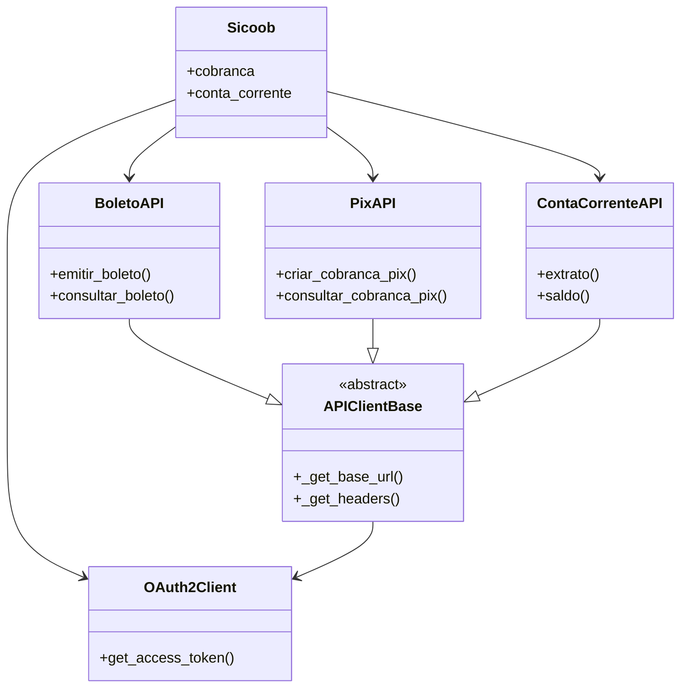

# Documentação da Biblioteca Sicoob API

## Visão Geral
Biblioteca Python para integração com a API do Banco Sicoob, incluindo:
- Autenticação OAuth2
- Cobrança (Boletos e PIX)
- Conta Corrente
- Operações bancárias

## Índice
1. [Classe Principal](#classe-sicoob)
2. [Autenticação](#autenticação-oauth2)
3. [Serviços](#serviços)
   - [Boletos](#api-de-boletos)
   - [PIX](#api-de-pix)
   - [Conta Corrente](#api-de-conta-corrente)
4. [Classe Base](#classe-base)
5. [Diagrama de Relacionamentos](#diagrama-de-relacionamentos)
6. [Exemplos de Uso](#exemplos-de-uso)

---

## Classe Sicoob
Cliente principal que fornece acesso a todos os serviços.

**Arquivo:** `sicoob/client.py`

### Métodos:
- `__init__(client_id=None, client_secret=None, certificado=None, chave_privada=None)`
  - Inicializa o cliente com credenciais

### Propriedades:
- `cobranca`: Acesso às APIs de Cobrança (Boleto e PIX)
- `conta_corrente`: Acesso à API de Conta Corrente

---

## Autenticação OAuth2
**Arquivo:** `sicoob/auth/oauth.py`

### Classe: OAuth2Client
Gerencia tokens de acesso com escopos específicos.

#### Métodos:
- `get_access_token(scope=None)`: Obtém token para o escopo especificado
- `_is_token_expired(scope)`: Verifica se token expirou (método interno)

#### Escopos Comuns:
- **Boletos**: `"boletos_inclusao boletos_consulta..."`
- **Conta Corrente**: `"cco_consulta cco_transferencias..."`
- **PIX**: `"cob.write cob.read..."`

---

## Serviços

### API de Boletos
**Arquivo:** `sicoob/boleto.py`

#### Classe: BoletoAPI
Operações com boletos bancários.

#### Métodos:
- `emitir_boleto(dados_boleto)`: Emite novo boleto
- `emitir_segunda_via(numero_cliente, codigo_modalidade, nosso_numero=None, linha_digitavel=None, codigo_barras=None, gerar_pdf=False, numero_contrato_cobranca=None, client_id=None)`:
  - Emite segunda via de um boleto existente
  - Parâmetros:
    - `numero_cliente` (int): Número do contrato do beneficiário
    - `codigo_modalidade` (int): Modalidade do boleto (1-8)
    - `nosso_numero` (int, opcional): Identificador do boleto
    - `linha_digitavel` (str, opcional): Linha digitável (47 posições)
    - `codigo_barras` (str, opcional): Código de barras (44 posições)
    - `gerar_pdf` (bool, opcional): Se True, retorna PDF em base64
    - `numero_contrato_cobranca` (int, opcional): ID do contrato de cobrança
    - `client_id` (str, opcional): ClientId para autenticação
  - Retorna: Dados do boleto ou PDF em base64 se gerar_pdf=True
  - Exceções: `BoletoEmissaoError` em caso de falha
- `consultar_boleto(nosso_numero)`: Consulta boleto existente
- `consultar_boletos_por_pagador(numero_cpf_cnpj, numero_cliente, client_id, codigo_situacao=None, data_inicio=None, data_fim=None)`:
  - Consulta lista de boletos por pagador
  - Parâmetros:
    - `numero_cpf_cnpj` (str): CPF/CNPJ do pagador (máx 14 caracteres)
    - `numero_cliente` (int): Número do contrato do beneficiário
    - `client_id` (str): ClientId para autenticação
    - `codigo_situacao` (int, opcional): Código da situação (1-Em Aberto, 2-Baixado, 3-Liquidado)
    - `data_inicio` (str, opcional): Data de vencimento inicial (formato yyyy-MM-dd)
    - `data_fim` (str, opcional): Data de vencimento final (formato yyyy-MM-dd)
  - Retorna: Lista de boletos encontrados
  - Exceções: `BoletoConsultaPagadorError` em caso de falha

- `consultar_faixas_nosso_numero(numero_cliente, codigo_modalidade, quantidade, client_id, numero_contrato_cobranca=None)`:
  - Consulta faixas de nosso número disponíveis
  - Parâmetros:
    - `numero_cliente` (int): Número do contrato do beneficiário
    - `codigo_modalidade` (int): Modalidade do boleto (1-Simples, 3-Caucionada, 4-Vinculada, 8-Conta Capital)
    - `quantidade` (int): Quantidade mínima de números disponíveis requeridos
    - `client_id` (str): ClientId para autenticação
    - `numero_contrato_cobranca` (int, opcional): ID do contrato de cobrança
  - Retorna: Dicionário com:
    - `numeroInicial`: Número inicial da faixa
    - `numeroFinal`: Número final da faixa
    - `validaDigitoVerificadorNossoNumero`: Indica se deve calcular DV (0-não, 1-sim)
  - Exceções: `BoletoConsultaFaixaError` em caso de falha
  - Exemplo:
    ```python
    faixas = sicoob.cobranca.boleto.consultar_faixas_nosso_numero(
        numero_cliente=123456,
        codigo_modalidade=1,
        quantidade=100,
        client_id="client-id-123"
    )
    ```

### API de PIX
**Arquivo:** `sicoob/pix.py`

#### Classe: PixAPI
Operações com PIX.

#### Métodos Principais:
- `criar_cobranca_pix(txid, dados)`: Cria cobrança imediata
- `consultar_cobranca_pix(txid)`: Consulta cobrança
- `configurar_webhook(chave, url)`: Configura webhook

### API de Conta Corrente
**Arquivo:** `sicoob/conta_corrente.py`

#### Classe: ContaCorrenteAPI
Operações bancárias.

#### Métodos:
- `extrato()`: Obtém extrato por período
- `saldo()`: Consulta saldo
- `transferencia()`: Realiza transferência

---

## Classe Base
**Arquivo:** `sicoob/api_client.py`

### Classe: APIClientBase
Fornece funcionalidades comuns a todas as APIs.

#### Métodos:
- `_get_base_url()`: Retorna URL conforme sandbox/produção
- `_get_headers(scope)`: Retorna headers com autenticação

---

## Diagrama de Relacionamentos



---

## Exemplos de Uso

```python
from sicoob import Sicoob
from sicoob.auth import OAuth2Client
import requests

# Configuração
oauth = OAuth2Client(client_id, client_secret, certificado, chave)
session = requests.Session()
sicoob = Sicoob(oauth_client=oauth, session=session)

# Uso dos serviços
extrato = sicoob.conta_corrente.extrato(
    mes=6, ano=2025, dia_inicial=1, dia_final=30, 
    numero_conta_corrente=123456
)

boleto = sicoob.cobranca.boleto.emitir_boleto({
    "numeroContrato": 123456,
    "modalidade": 1,
    "valor": 100.50
})

boletos_por_pagador = sicoob.cobranca.boleto.consultar_boletos_por_pagador(
    numero_cpf_cnpj="12345678901",
    numero_cliente=123456,
    client_id="client-id-123",
    codigo_situacao=1,  # Em Aberto
    data_inicio="2025-01-01",
    data_fim="2025-06-30"
)

segunda_via = sicoob.cobranca.boleto.emitir_segunda_via(
    numero_cliente=123456,
    codigo_modalidade=1,
    nosso_numero=987654321,
    gerar_pdf=True
)

pix = sicoob.cobranca.pix.criar_cobranca_pix(
    "tx123", 
    {"valor": {"original": "100.50"}}
)
